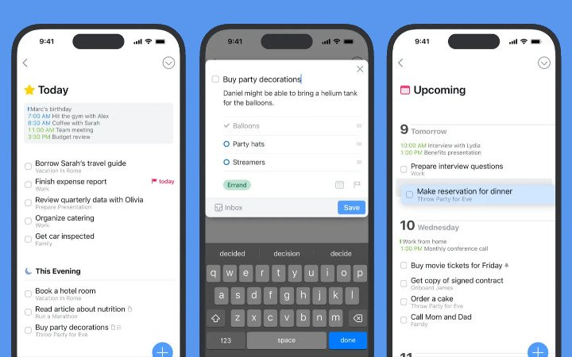
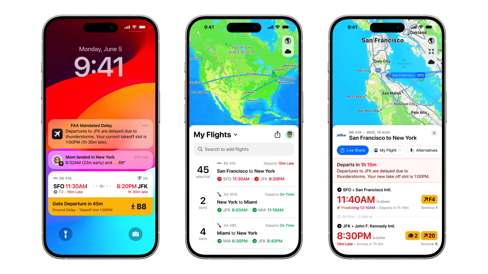
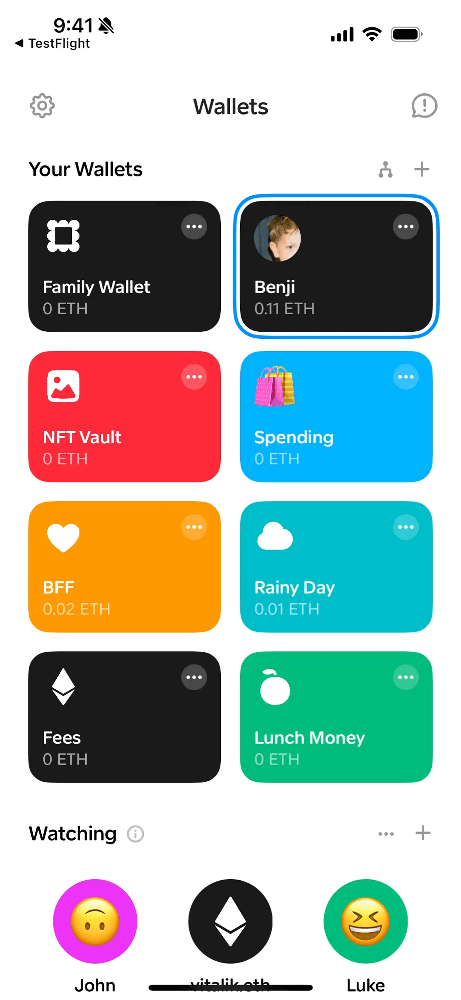
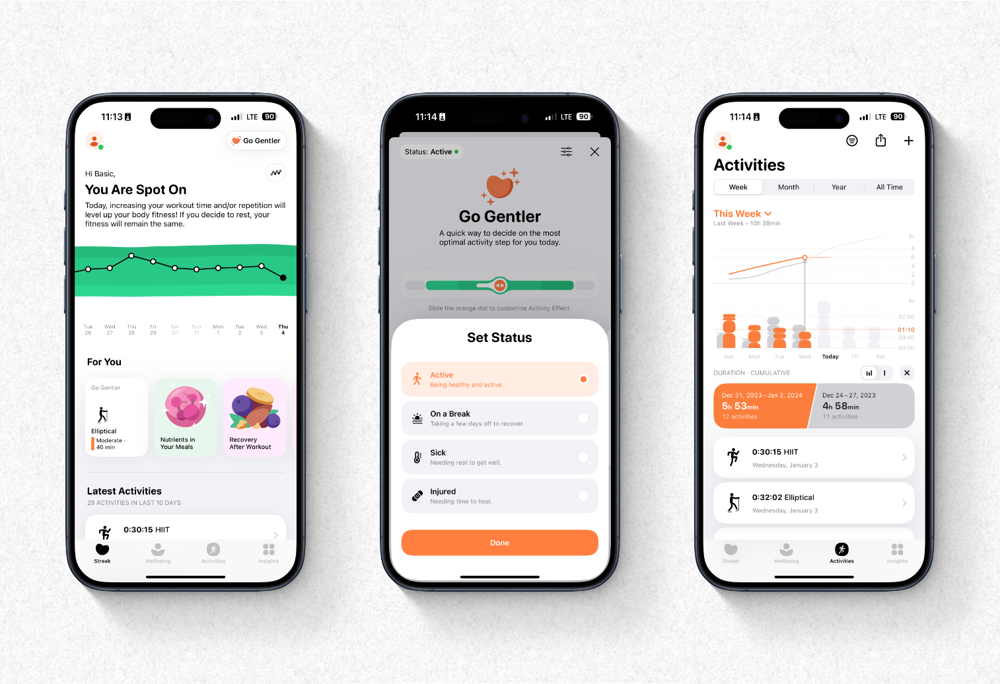
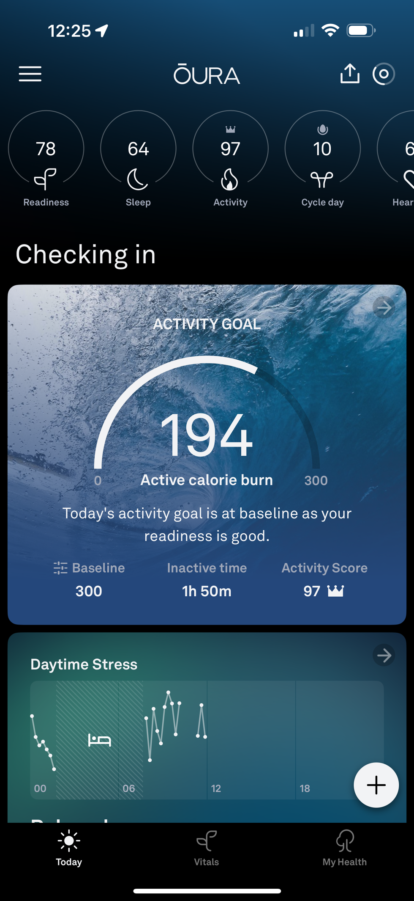
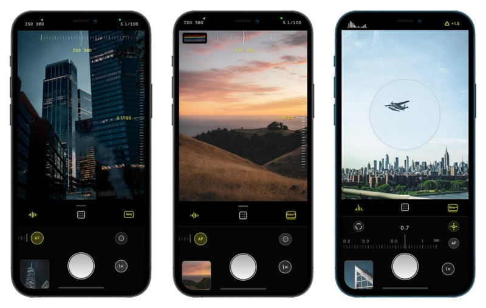
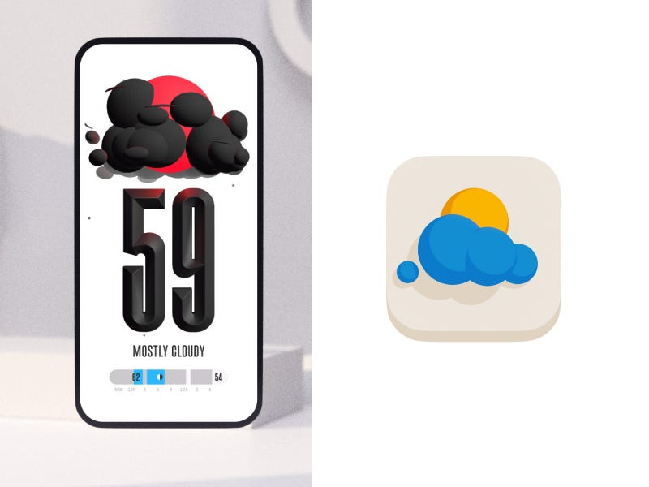

# Adam layout study — full rebuild

23 October 2026. Codex's visual analysis for discussion with Claude and Chizi. This is a design contribution, not an implementation prescription. [Full scope](REBUILD_BRIEF.md) · [All reference images and sources](VISUAL_REFERENCES.md).

## The whole experience is the subject

Chizi wants the existing UI rebuilt from the ground up. The wheel is one liked interaction to try to retain. It is not the scope of the redesign. A new colour palette, coloured icon tiles or replacing Today cards with rows would not on their own fulfil this request.

Layout is how the screen allocates attention and space: what leads, what belongs together, what can be scanned, what waits until needed and where the next action lives. The references offer different answers to those questions, not just different colours.

## What the selected layouts actually do

### Things — arrange time and task detail at different levels

The Today screen separates scheduled events, task rows and evening items. A row has a title and subordinate context; the title does not need its own large card. The task-entry screen gives editing a focused surface while the list remains behind it. Upcoming introduces dates as real grouping boundaries instead of repeating the same metadata in every row.

**Structural lesson for Adam:** group content by a relationship people understand, then keep repeated items compact. A conversation, a memory and a permission decision need different amounts of space. Use the list pattern for repeated short things, rather than making every Adam surface a list.

### Flighty — overview and detail are different compositions

The overview combines a contextual map with a list below. Each flight has a large time-to-event column and a consistent route/status column. The detail view changes composition: identity and actions sit above the important disruption, followed by structured departure and arrival facts. It is not the overview row enlarged to fill the screen.

**Structural lesson for Adam:** a glanceable work summary should open a purpose-built detail view. A decision needs the actual object, consequence and action; an outcome needs the changed fact and evidence. These should not all be long paragraphs in identical bubbles. Context above and action below can share a surface without becoming nested cards.

### Family — give real objects an identity and a stable place

Wallets use a two-column collection: identity at the top, label and balance at the bottom, overflow in the same corner. Selection outlines the whole selected object. The separate Watching section changes to circular identities; that change in shape communicates a different kind of relationship.

**Structural lesson for Adam:** use object-based composition where the content genuinely consists of objects, such as existing connected services or devices. A collection can be visual and recognisable without a paragraph for each item. Distinguish relationships through grouping and composition, not just coloured backgrounds. Do not turn unrelated tasks into wallet tiles because they are attractive.

### Gentler Streak — an overview, a choice and a history each get their own layout

The overview starts with a short status and a broad visual context area, then separates suggestions from recent activity. A status choice appears in a sheet with comfortably sized options and one clear completion action. The history view uses period selection, a summary graphic and repeatable entries. These are three distinct layouts within one visual language.

**Structural lesson for Adam:** choose composition by what the person is doing. Reading a household update, answering a request and inspecting past work are different activities. They should share visual grammar without being forced into the same page template. Hierarchy can stay friendly and distinctive while remaining organised.

### Oura — prioritise one useful subject, then give depth

This replacement capture places compact summaries above a large focal subject, followed by another detailed section. It uses scale and sequence to establish what deserves attention. The main panel is substantial because it contains a primary value, context and subordinate measures, not because every item receives equal space. The original linked capture is unavailable; this is the labelled alternative documented in VISUAL_REFERENCES.md.

**Structural lesson for Adam:** the most important real observation or decision can deserve a different composition from routine items. Do not invent a household score or add a large hero region when there is nothing meaningful to put in it. In a quiet state, a simple, useful opening can be better than an empty hero.

### Halide — place controls around the thing they operate

The viewfinder occupies most of the screen; primary controls live in a dedicated lower area. The shutter is immediately distinct from secondary adjustments. Extra precision controls can appear near the main operation without replacing its focal point.

**Structural lesson for Adam:** voice/device interaction should have an unmistakable primary operation and visible state. The request composer and navigation should have intentional space, not obscure the thing being read. A control cluster is appropriate where someone is actively operating something, not as decoration on every page.

### !Boring Weather — make one subject memorable through composition

The weather object and large temperature form the composition. Supporting information occupies a small lower band. The personality comes from scale, silhouette and material as much as colour. Copying a weather icon while keeping Adam's current screen structure would miss that lesson.

**Structural lesson for Adam:** test a deliberately expressive focal element where one real state deserves it, and make the surrounding layout serve it. This is a genuine alternative to a fully quiet composition, not merely a colourful icon added after the layout is finished. It must still carry a meaningful role in Adam.

## Apply that thinking to the whole app

These are questions and visual opportunities for us to resolve, not a mandatory screen map. Existing capability names below describe the subject; they do not require preserving current labels or screens.

| Part of the experience | Layout problem to solve afresh | Useful references | What would be a superficial response? |
| --- | --- | --- | --- |
| Main entry / everyday overview | What deserves the first glance? How do quiet, busy and needs-you states differ? How does someone start a request? | Oura, Gentler Streak, Flighty | Keeping the current composition and adding a hero card or recoloured background. |
| Conversation and new requests | How do text, attachments, useful visual answers and ongoing work coexist? Where do input and navigation live without covering content? | Things' focused editing, Halide's control placement, Flighty's overview/detail distinction | Keeping identical bubbles for every kind of content and only changing their corners. |
| Active work | How can someone understand the real current state, inspect detail and continue their day? | Flighty | Adding a generic spinner, invented percentage or another activity dashboard. |
| Approvals and decisions | What is being decided, what will happen, and where are the available actions? Which facts must be visible together? | Gentler Streak's focused choice surface, Flighty's structured facts | A large button attached to an unexplained paragraph. |
| Outcomes and history | What changed? How is the result evidenced? How does an overview lead into detail? | Flighty, Things | Reusing the active-work layout with a green tick and “Done”. |
| Memory and personal context | What can be scanned, searched and opened? What is a fact, a source or a group? How is retained content inspectable? | Things, Family's relationship grouping | Keeping repeated headings and empty space while changing text colour. |
| Services, household devices and controls | What real objects exist, which are connected, and how does someone operate or manage one? | Family, Halide | A generic integration catalogue or made-up smart-home tiles. |
| Settings and account | How are existing controls grouped by the person's intent? Can people find them and return without getting lost? | Things' hierarchy, Gentler Streak's focused choices | Renaming settings or moving them behind chat without resolving discovery. |
| Navigation and the wheel | How does the liked spin fit the new architecture? Is the current location and destination clear? | Existing wheel, Family selection, Halide control hierarchy | Letting the wheel dictate every other screen or treating wheel polish as the whole rebuild. |

## Explore a coherent composition, not seven borrowed skins

My suggestion is to compare two genuinely different arrangements of the main experience: one led by a grounded current observation/decision with supporting content below, and another led by the conversation with work and decisions integrated into it. Both can keep the wheel. Carry each far enough through a request, an approval and a result to see whether it remains coherent. These are starting ideas for Claude to challenge; Chizi has not selected either structure.

The comparison should include real content at useful density, not empty screens made attractive by whitespace. Also include a quiet state. A design that only looks good when a major event fills the top third of the screen is incomplete.

Once a direction is chosen, translate it consistently through the rest of the existing capabilities. Decide the hierarchy, spacing, control positions and relationship between overview and detail together. Use one underlying visual grammar even when individual task surfaces have different compositions.

## Review the result as a product

Put representative screens together at readable size, then follow the transitions between them. Can a person understand where they are, what matters and what happens next? Does the input remain reachable? Does a detail view retain its context? Does the wheel feel part of the same product? Do longer content and larger text remain comfortable?

Colour, icons, material and motion should reinforce those decisions. They cannot compensate for an unresolved layout. Conversely, efficient rows alone do not capture all of the character Chizi liked.

Claude owns design implementation and should form its own opinions from the images. Codex supports with visual comparisons and critique. Chizi judges the actual experience; “perfect” is an ambition for the work, not a result established by a written brief or two agents agreeing.
